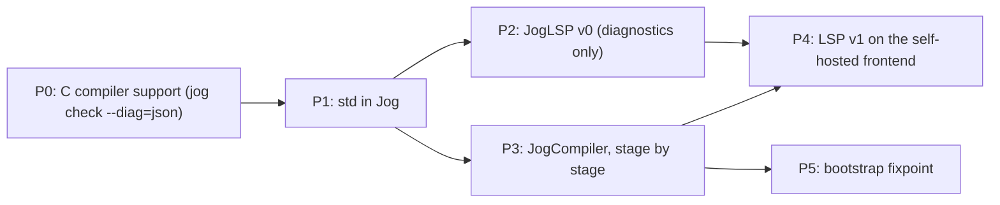

# Bootstrap roadmap

This is the hub for writing Jog in Jog. The goal is a self-hosted compiler, `jogc`, and a language server, both written mostly by hand. The work has two purposes: it tests whether Jog is pleasant to use on real programs, and it is a course in compiler design. Every phase has a checklist in [[bootstrap/Checks]], and every rough edge goes into [[bootstrap/Friction]].

The C compiler in this repo, `jog`, is stage 0. It is about 53k lines in `compiler/src` and supports `jog lex`, `parse`, `check`, `emit-ir`, `emit-c`, `build`, `run` and `test`. It stays the reference: each stage of `jogc` is correct when its output matches `jog` on the same input.

## Repositories

| Repo | Holds |
|---|---|
| CTools (this one) | the C compiler, the runtime, `std/`, and these notes |
| [JogCompiler](https://github.com/Jog-lang/JogCompiler) | `jogc`, the self-hosted compiler |
| [JogLSP](https://github.com/Jog-lang/JogLSP) | the language server in `server/`, and the editor extension in `editors/vscode/` |

Both new repos contain only a LICENSE and a README. Their skeletons (`jog.mod`, folder layout, a README that says how to build) are the first items in [[bootstrap/Checks]].

## Order, and why

Start with neither the compiler nor the full LSP. **Start with std.** Today `std/` has only `c`, `cmp`, `io`, `mem` and `testing`. There is no growable list, hash map, string builder, arena, directory listing or process spawning, and both the compiler and the LSP need all of them. Writing them is also the cheapest first test of Jog: a hash map exercises generics, pointers, allocators and error returns in a few hundred lines.

Then write a **small LSP in Jog**. It speaks JSON over stdio and reports the diagnostics of `jog check`. That is a few thousand lines, so Jog gets tested on a real program with I/O, parsing and state before you commit to a 50k-line rewrite. It also gives you squiggles in the editor while you write the compiler.

The compiler comes third, one stage at a time, each stage checked against the C compiler before the next starts. The LSP moves onto the new frontend once that frontend exists, and the bootstrap closes when `jogc` compiles itself to a fixed point.

P2 and P3 can overlap once P1 is done. If the LSP stalls, the compiler does not wait for it.

## Phases

### P0: C compiler support

Work in CTools, done for you on request.

- `jog check --diag=json`: one JSON object per line on stdout, with `file`, `line`, `column`, `severity` and `message`. Text diagnostics today look like `file:line:col: error: message` (see `tools/diag.c`), which is parseable in a pinch, but JSON is a stable contract the LSP can rely on.
- Fixes for C compiler bugs found in later phases. Each fix gets a regression test under `tests/` and a line in [[bootstrap/Friction]].

### P1: std in Jog

You write it, in `std/`. Each package gets `*.test.jog` files run by `jog test`.

- `List<T>`: a growable array with push, pop, index, slice view and clear.
- `Map<K, V>`: open addressing, FNV-1a hashing, deletion with tombstones or backward shift, growth at a load factor you choose and write down.
- `StrBuilder`: append `str`, bytes, chars and integers; produce a `str` at the end.
- An arena allocator that implements the `Allocator` interface from `std.mem`. See [[design/language/Memory]].
- `fs`: read a whole file, write a file, list a directory, join paths.
- `proc`: spawn a process with arguments, capture stdout and stderr, wait for the exit code.
- `os`: program arguments and environment variables.
- Integer formatting and parsing, in any base the compiler needs.

Study first: [[bootstrap/study/DataStructures]].

### P2: JogLSP v0

You write the server, in JogLSP's `server/`. It is a warm-up: diagnostics only.

- Content-Length framing over stdin and stdout.
- A JSON parser and writer. Small, strict, and tested on a corpus of valid and invalid documents.
- The lifecycle: `initialize`, `initialized`, `shutdown`, `exit`.
- Document sync: `didOpen`, `didChange` (full sync is enough), `didSave`, `didClose`.
- On save, run `jog check --diag=json` through `proc`, group the results by file, and send `textDocument/publishDiagnostics`. Send an empty list for files that no longer have errors, or the squiggles never clear.

`editors/vscode/` holds a TextMate grammar, a language configuration (comments, brackets, auto-closing pairs) and a thin TypeScript client that starts the server. The client is boilerplate and can be scaffolded for you, since it isn't the part you want to learn.

Study first: [[bootstrap/study/LSP]].

### P3: JogCompiler

You write it. Each stage must match `jog` before the next one starts. The differential script `scripts/diff_stage.ps1`, described in [[bootstrap/Checks]], is what "match" means.

1. **Lexer.** `jogc lex f` prints exactly what `jog lex f` prints, including the inserted separators from the newline rule. See [[bootstrap/study/Lexing]] and `compiler/src/lexer.c`.
2. **Parser and AST printer.** `jogc parse f` prints exactly what `jog parse f` prints. The printer format is defined by `compiler/src/ast_print.c`, and `tests/parse/*.ast` are golden files. See [[bootstrap/study/Parsing]].
3. **Loader and resolver.** Find the module root from `jog.mod`, map imports to folders, build package scopes, resolve names in bodies. See [[bootstrap/study/NameResolution]] and `loader.c`, `resolve_package.c`, `resolve_universe.c`.
4. **Checker.** First for the subset of Jog that `jogc` itself uses, then the rest. Every `tests/check` case must report the same errors. See [[bootstrap/study/TypeChecking]] and `check.c` with its `check_*.c` helpers.
5. **Lowering to IR.** `jogc emit-ir` should match `jog emit-ir` closely enough to diff. See [[bootstrap/study/IR]] and `lower.c`, `ir.h`.
6. **C emitter and driver.** Generate one C file, call clang or gcc, link the runtime. See [[bootstrap/study/CodeGen]] and `emit_c.c`, `cc.c`.

Open decision, to record here when you reach stage 4: does the checker resolve top-level declarations on demand with Jog coroutines, the way the C version does with `tools/coro.h` (described in [[plans/V1Compiler]]), or with a plain worklist and an explicit "in progress" mark for cycle detection? Coroutines test a Jog feature; a worklist is easier to debug. Write down which one and why.

### P4: LSP v1

JogLSP imports the JogCompiler frontend as a package instead of running `jog check`. That makes the richer features possible: hover, go to definition, document symbols and completion. Two things become important here that the batch compiler could ignore:

- **Error-tolerant parsing.** A file being edited is broken most of the time. The parser must still produce a tree with error nodes so hover and completion keep working.
- **Positions.** LSP counts columns in UTF-16 code units by default. The compiler counts bytes. Convert at the boundary, in one place.

### P5: bootstrap

- Stage 0, the C `jog`, builds stage 1 from JogCompiler's source.
- Stage 1 builds stage 2. Stage 2 builds stage 3.
- Stage 2 and stage 3 must generate byte-identical C. If they differ, the compiler's output depends on something other than its input (hash map iteration order, pointer values, timestamps), and that is a bug.

After that the C compiler is frozen as the bootstrap seed. It only changes to keep building `jogc`. See [[bootstrap/study/Bootstrapping]] and [[plans/Bootstrap]].

## Working mode

- **Ivan** writes all Jog code in std, JogLSP and JogCompiler.
- **The agent** reviews, explains the idea behind each stage, points to how the C V1 does it, writes test corpora on request, fixes C-compiler bugs, and keeps these notes current.
- **Every rough edge** in Jog goes into [[bootstrap/Friction]]: what happened, the workaround, and the language or std change it suggests. That log is the usability result of this project.
- **A stage is done** when its section in [[bootstrap/Checks]] is all ticked, not when the code looks finished.

## How to use these notes

For each phase: read the study note, skim the matching C files to see one working answer, answer the questions in the study note in your own words, then write the Jog code. [[bootstrap/Reading]] lists the books and articles for each topic.

- [[bootstrap/study/DataStructures]]: arenas, interning, hash maps.
- [[bootstrap/study/Lexing]]: tokens, the newline rule, string interpolation.
- [[bootstrap/study/Parsing]]: recursive descent, precedence climbing, error recovery.
- [[bootstrap/study/NameResolution]]: scopes, packages, imports.
- [[bootstrap/study/TypeChecking]]: types, inference, generics, diagnostics.
- [[bootstrap/study/IR]]: three-address code and basic blocks.
- [[bootstrap/study/CodeGen]]: C as a target.
- [[bootstrap/study/LSP]]: the protocol and IDE architecture.
- [[bootstrap/study/Bootstrapping]]: stages, seeds and fixpoints.

## See also

- [[bootstrap/Checks]]
- [[bootstrap/Friction]]
- [[bootstrap/Reading]]
- [[plans/Bootstrap]]
- [[plans/V1Compiler]]
- [[design/Compiler]]
- [[design/language/Grammar]]
- [[design/language/OpenQuestions]]
- [[Home]]
